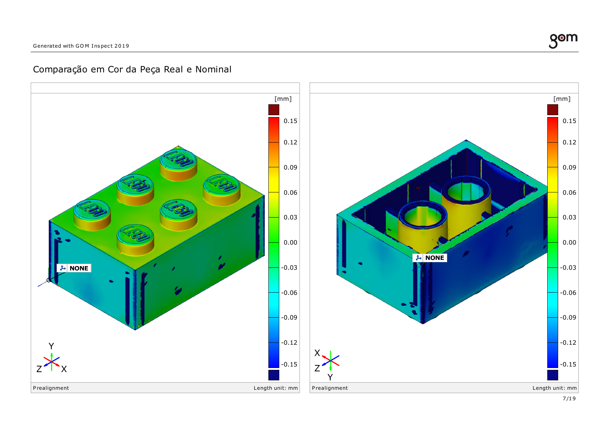
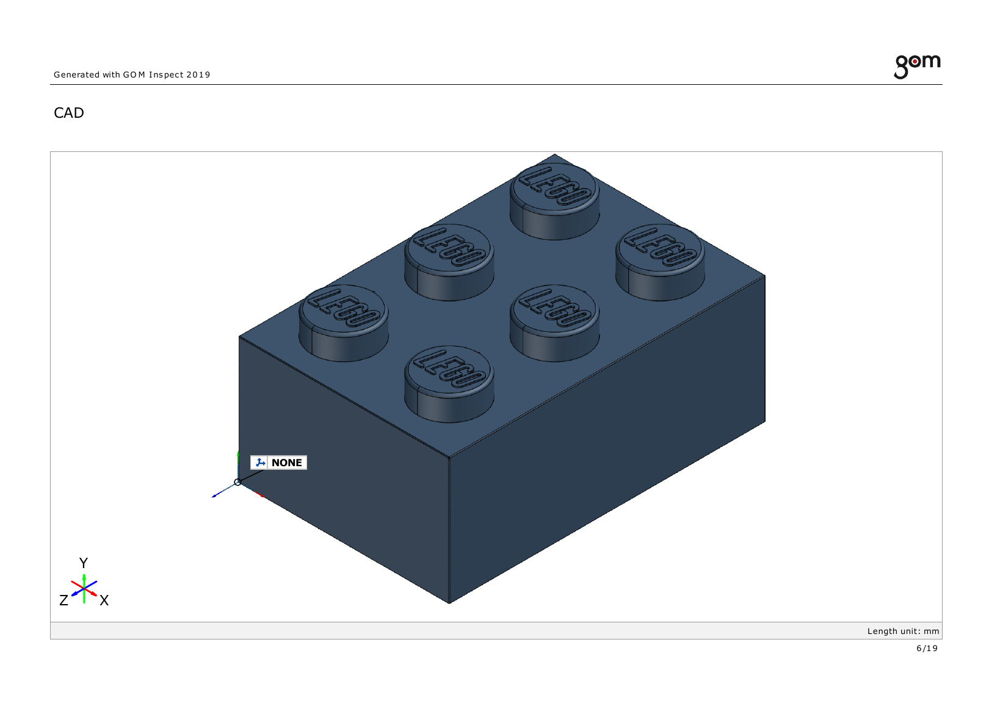
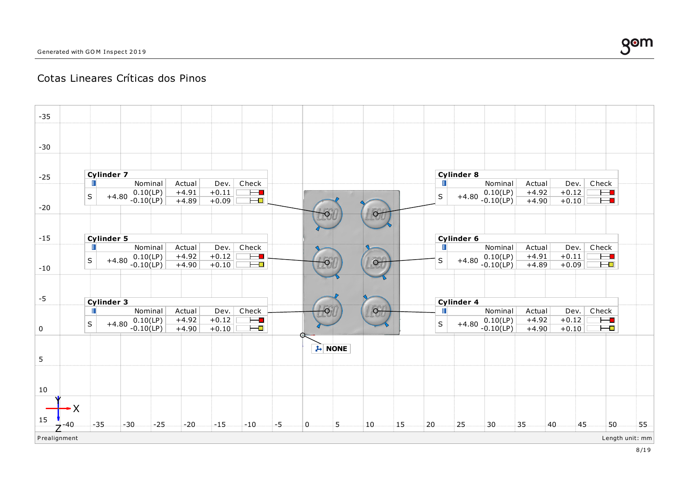
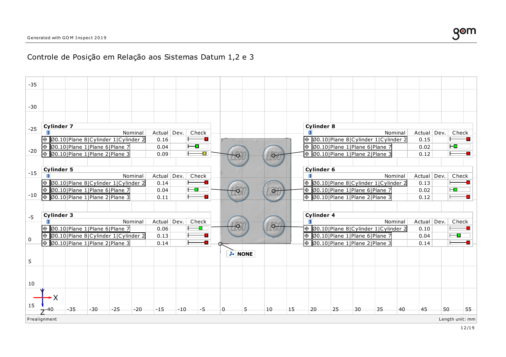

# Dimensional and Geometric Metrology Analysis with GOM Inspect

Inspection of a LEGO 2x4 brick in GOM Inspect 2019: the 3D scan of the real part is aligned to its CAD model, and sizes, form, orientation and position are checked against GD&T tolerances.



## Overview

Metrology project at UTFPR (Mechatronics Engineering, June 2024). The scanned mesh of the brick was compared with the nominal CAD model, three datum reference frames were built from planes and cylinders of the part, and the critical features (top studs and bottom tubes) were inspected for size, cylindricity, flatness, perpendicularity and position.

## Method

1. **Alignment:** pre-alignment of the scan mesh to the CAD model, then three datum systems: planes 1, 2 and 3; planes 1, 6 and 7; and plane 8 with the two bottom tubes (cylinders 1 and 2).
2. **Surface comparison:** color map of the deviation between the real part and the nominal model, on a ±0.15 mm scale.
3. **Feature inspection:** cylinders fitted to the six studs and to the two bottom tubes, planes fitted to the top face and to the bottom contact faces.
4. **Report:** size, form, orientation and position checks generated in GOM Inspect.



## Results

Tolerances used in the inspection: ±0.10 mm on sizes and 0.10 mm on form and position.

| Feature | Nominal | Measured | Result |
|---|---|---|---|
| Stud diameter (6 studs, two-point size) | 4.80 mm | 4.89 to 4.92 mm | 0.09 to 0.12 mm above nominal, every stud above the 4.90 mm upper limit over part of its height |
| Bottom tube diameter (2 tubes) | 6.40 mm | 6.50 to 6.57 mm | 0.10 to 0.17 mm above nominal, at or above the upper limit |
| Cylindricity of the studs | 0.10 mm | 0.01 to 0.02 mm | Within tolerance |
| Cylindricity of the bottom tubes | 0.10 mm | 0.04 mm | Within tolerance |
| Flatness of the top face | 0.10 mm | 0.03 mm | Within tolerance |
| Flatness of the bottom contact faces (10 faces) | 0.10 mm | 0.01 to 0.02 mm | Within tolerance |
| Surface profile of the top face (one check per datum system) | 0.10 mm | 0.03 to 0.04 mm | Within tolerance |
| Perpendicularity of the studs and tubes | 0.10 mm | 0.00 to 0.01 mm | Within tolerance |
| Position of the studs (Ø0.10 mm) | 0.10 mm | 0.02 to 0.16 mm, depending on the datum system | All six studs within tolerance only in the datum system built on planes 1, 6 and 7 |
| Position of the bottom tubes (Ø0.10 mm) | 0.10 mm | 0.01 to 0.23 mm, depending on the datum system | Out of tolerance in two of the three datum systems |

The studs and tubes came out slightly larger than the CAD model, while form errors stayed well inside tolerance. The position results depend strongly on the datum system, which shows how the choice of datums changes the verdict on the same part.

| Stud diameters | Stud position |
|---|---|
|  |  |

## Files

```
data/metrology-project.ginspect   GOM Inspect project (scan mesh, CAD, alignments and checks)
report/inspection-report.pdf      full inspection report generated by GOM Inspect (19 pages)
images/                           pages of the report
```

The project opens in GOM Inspect 2019 or later. Labels in the report are in Portuguese.

## Author

Felipe Martins, Mechatronics Engineering student at UTFPR, double degree at ENSTA.
[LinkedIn](https://www.linkedin.com/in/felipe-m-k-m-martins)
